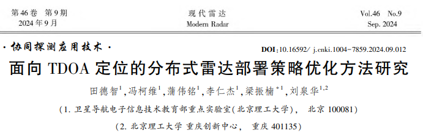
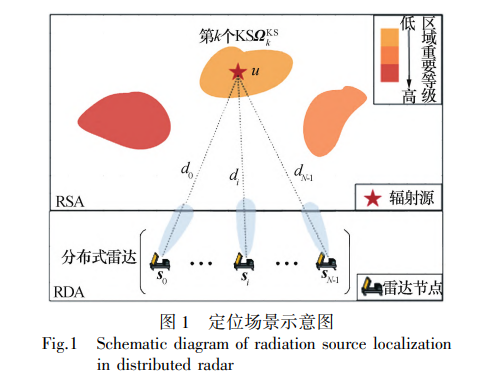
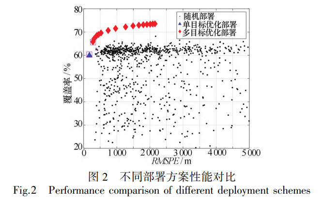
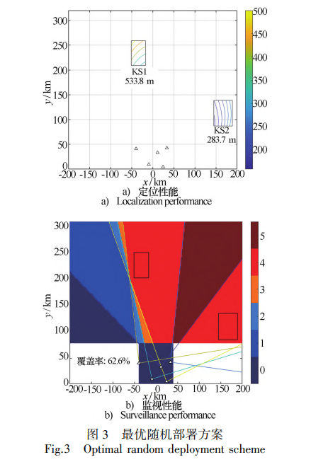
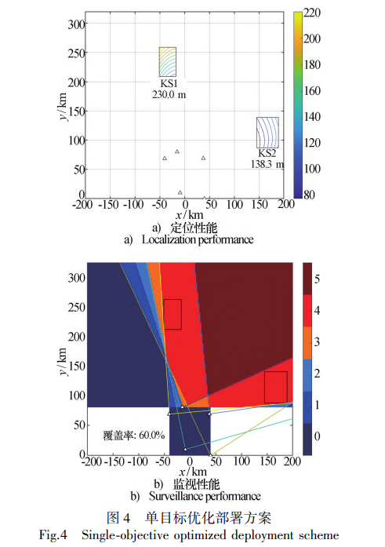
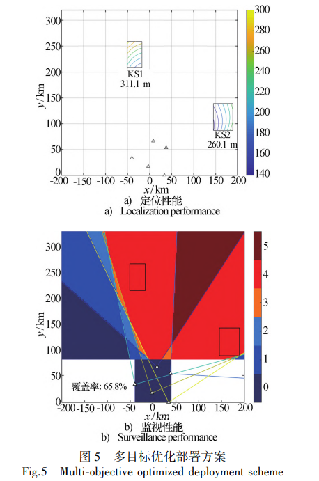
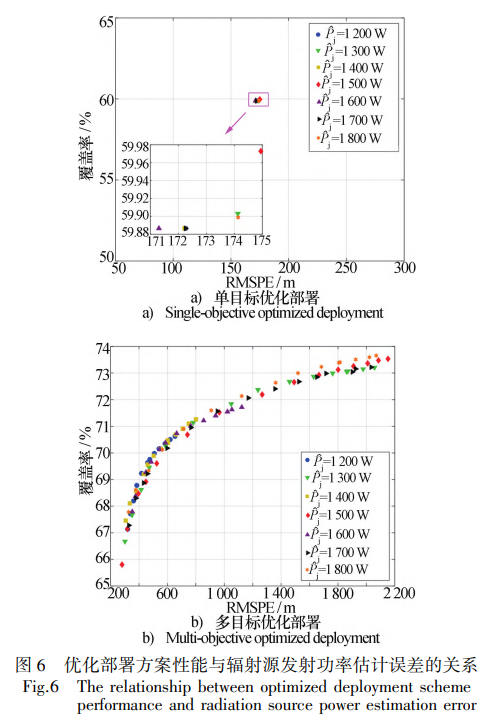

# Research on Distributed Radar Deployment Strategy Optimization Methods for TDOA-Based Localization

1. Abstract: In the task of Time Difference of Arrival (TDOA) passive positioning, this paper focuses on the optimization of distributed radar deployment strategies to enhance system positioning and surveillance performance. While existing research primarily focuses on node position optimization, it overlooks the coupling relationship between node normal vector orientation and system surveillance performance. Taking practical application scenarios into account, this paper proposes a joint optimization strategy for node position and normal vector orientation, constructing single-objective optimization problems for positioning tasks and multi-objective optimization problems that balance positioning and surveillance tasks.
Due to the complex coupling constraints and non-convex characteristics of these optimization problems, it is difficult to obtain analytical solutions. Therefore, this paper proposes a Regional Constraint Multi-Objective Particle Swarm Optimization (RC-MOPSO) algorithm to solve for the optimal deployment strategy. By introducing constraints in the particle initialization and updating process, the algorithm ensures that the particle iteration always satisfies the complex coupling constraints. Simulation results show that the proposed scheme achieves an optimal balance between positioning and surveillance performance, significantly outperforming random deployment schemes, while also demonstrating strong robustness against estimation errors in radiation source emission power.
II. Introduction
Among various positioning methods, the TDOA-based method does not rely on waveform prior information, has high positioning accuracy and is robust against multipath effects, with significant application potential. However, a reasonable node deployment strategy is key to unlocking its full potential —— node layout directly affects system energy efficiency, positioning accuracy, and coverage range, among other performance metrics. Optimizing deployment can achieve optimal positioning efficacy within resource constraints.
The existing research has made progress in enhancing the performance of distributed radar positioning and surveillance, but it is mostly limited to node position optimization. It does not fully consider the coupling relationship between node normal vector orientation and system surveillance performance, which may lead to unsatisfactory surveillance effects in actual system applications. To address this issue, this paper comprehensively considers the joint optimization of node position and normal vector orientation, constructs single-objective and multi-objective optimization problems, and proposes an RC-MOPSO algorithm to tackle non-convex optimization challenges under complex constraints. The scheme's advantages are ultimately verified through simulation.
III. Main Principles (I) Radiation Source Passive Localization Based on TDOA
Localization Scenario Definition
The distributed radar localization scenario includes the Radar Reconnaissance Area (RSA) and the Radar Deployment Area (RDA). The region within RSA where radiation sources are highly likely to appear is defined as the Key Sub-Area (KS). The system consists of N known-coordinate directional radars, each with its azimuth normal vector orientation and maximum beam scanning angle, capable of receiving signals from unknown coordinates radiation sources. The localization is achieved by calculating TDOA.
Since the arrival distance difference (RDOA) and TDOA have a "RDOA = c・TDOA" relationship (c being the speed of light), for ease of derivation, this paper uses RDOA instead of TDOA for localization calculation.
2
Measurement Model and Error Analysis
Assuming the reference radar position is, distributed radars can obtain RDOA measurements, represented by the measurement vector, where represents the true RDOA vector (, represents the true distance between the radiation source and the first radar), and represents the measurement error vector (following a zero mean Gaussian independent distribution, with covariance matrix).
At the same time, there are errors in the radar station positions, represented by, representing the true station positions, and represents the station position errors (also following a zero mean Gaussian independent distribution).
3
Localization Accuracy Evaluation
The root mean square position error (RMSPE) is used to measure the system's positioning performance, reflecting the impact of measurement errors, station site errors, and the geometric layout of radar nodes and radiating sources on positioning accuracy. The formula is as follows: where  is the trace of the matrix,  is the covariance matrix of the positioning error, and can be derived from the measurement error covariance matrix, station site error correlation matrix, etc. - The smaller the RMSPE value, the more noise in the SNR related to the measurement error is reduced under the current geometric configuration, or the amplification effect on positioning error is weaker, making the geometric configuration more robust.
(II) Optimizing Model Construction Principles
Performance evaluation indicators
•  
KS Positioning Performance Metrics: Distribute the RSA into a grid of points, defining a distributed radar deployment scheme (for node position vectors, for normal vectors pointing directions). Take the maximum RMSPE across all grid points within each KS as the performance metric for positioning. Combine the positioning weights (reflecting importance) with the desired positioning accuracy to construct a positioning performance objective function. Evaluate whether each KS meets the desired precision through an utility function.
•  
RSA Monitoring Performance Indicators: When the RSA grid points are covered by radar beams from four or more radar nodes, they are considered valid monitoring points. The effective coverage rate of the monitoring area (the proportion of valid monitoring points to the total grid points in RSA) is used as a performance evaluation metric, formulated as follows, where is a boolean function determining whether a point is a valid monitoring point.
1  
Optimization problem construction
•  
Single-objective optimization: aiming to minimize the positioning performance objective function, with constraints that nodes' positions must fall within RDA and radar beams need to cover all KS boundary points (ensuring positioning requirements).
•  
Multi-objective optimization: Considering both positioning and surveillance performance, aiming to minimize the "Positioning Performance Objective Function" and "1 - Effective Surveillance Area Coverage", with constraints consistent with single-objective optimization. Both types of optimization problems require heuristic algorithms to solve due to complex coupled constraints and non-convex characteristics.
(III) RC-MOPSO Algorithm Principles
1  
Constraint Random Initialization: When initializing particle positions (representing deployment schemes) ensure that the node positions are within the RDA and that the beam covers the specified KS boundary points, with the node normal pointing within the "minimum / maximum angle range for first coverage of all target boundary points".
2  
Particle Update Rules: Update the particle's velocity and position according to the formula. Set speed boundaries to prevent disorderly expansion or excessive oscillation. If the position / velocity exceeds the constraint range, pull it back to the nearest boundary.
3  
Optimal Particle Update: Individual optimal particles are updated based on the dominance relationship between the current position and the historical optimal position in the objective function. Globally optimal particles are selected from the external archives based on "least sparse" particles (determined by computing the relative distance between particles), ensuring diversity in the solution set.
IV. Conclusion This paper proposes an optimized method for distributed radar deployment strategies aimed at TDOA positioning, effectively addressing the shortcomings of existing methods that fail to fully consider the coupling relationship between node normal vector orientation and system surveillance performance:
1  
A single-objective (positioning performance) and multi-objective (positioning + surveillance performance) optimization model that combines node positioning with normal vector orientation is constructed, which better fits the actual application scenarios.
2  
The RC-MOPSO algorithm is proposed to solve the non-convex optimization problem under complex coupling constraints, ensuring that the iterative process meets the constraints.
3  
Simulation results verify that the multi-objective optimization deployment scheme outperforms the random deployment scheme in terms of positioning and surveillance performance, and exhibits good robustness in estimating the emission power of radiation sources.
Future research will further incorporate the node-to-KS pairing strategy into optimization problems, enhancing the algorithm's applicability.

## Images

<!-- PAYMENT_BLOCK -->

## Get this dataset

- Payment link (Stripe): [Buy now](https://buy.stripe.com/3cs8yP7sY87d0vu9AB)
- Payment QR code: 

<!-- /PAYMENT_BLOCK -->
